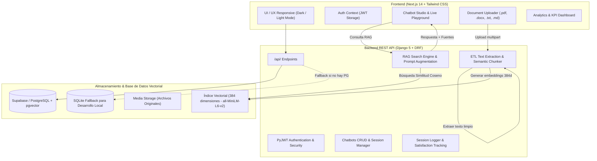

# Alma Project — Plataforma Empresarial de Chatbots RAG & Pipeline ETL

[](https://github.com/Orieblax/Alma-Project/actions/workflows/ci-backend.yml)
[](https://github.com/Orieblax/Alma-Project/actions/workflows/ci-frontend.yml)
[](https://github.com/Orieblax/Alma-Project/actions/workflows/ci-docker.yml)
[](https://github.com/Orieblax/Alma-Project/actions/workflows/deploy-vercel.yml)
[](https://github.com/Orieblax/Alma-Project/actions/workflows/deploy-backend.yml)

Plataforma integral y moderna para la creación, entrenamiento e interacción con **Chatbots inteligentes impulsados por Generación Aumentada por Recuperación (RAG)** y un **Pipeline ETL automatizado de documentos**. Permite a organizaciones y usuarios cargar manuales, políticas y documentación en formatos PDF, Word (.docx), TXT y Markdown, vectorizarlos semánticamente y habilitar asistentes conversacionales de alta precisión con citación exacta de fuentes y métricas de analítica en tiempo real.

---

## Tabla de Contenidos
1. [Arquitectura del Sistema](#arquitectura-del-sistema)
2. [Stack Tecnológico](#stack-tecnológico)
3. [Requisitos Previos](#requisitos-previos)
4. [Instalación y Configuración Local](#instalación-y-configuración-local)
   - [Configuración del Backend (Django)](#1-configuración-del-backend-django)
   - [Configuración del Frontend (Next.js)](#2-configuración-del-frontend-nextjs)
5. [Variables de Entorno](#variables-de-entorno)
6. [Pipeline ETL & Motor RAG](#pipeline-etl--motor-rag)
7. [Referencia de la API REST](#referencia-de-la-api-rest)
8. [Pruebas Automatizadas](#pruebas-automatizadas)
9. [Integración Continua y Despliegue (CI/CD)](#integración-continua-y-despliegue-cicd)
   - [GitHub Actions Workflows](#github-actions-workflows)
   - [Despliegue a Producción (Vercel + Render + Supabase)](#despliegue-a-producción)

---

## Arquitectura del Sistema



---

## Stack Tecnológico

### Frontend
- **Framework:** Next.js 14 (React 18, App Router)
- **Estilos:** Tailwind CSS con soporte nativo de modo Claro / Oscuro
- **Iconografía:** Lucide React
- **Gestión de Estado:** Context API + LocalStorage para persistencia de sesión JWT

### Backend
- **Framework:** Python 3.11+ / Django 5+ & Django REST Framework (DRF)
- **Seguridad:** Autenticación JWT sin estado con `PyJWT` y rotación de tokens
- **CORS:** `django-cors-headers` configurado para orígenes cruzados seguros
- **Driver de Base de Datos:** `psycopg[binary]>=3.1` y `pgvector>=0.2.5`

### ETL & Inteligencia Artificial (RAG)
- **Extracción de Documentos:** `pypdf>=4.0` (PDFs) y `python-docx>=1.1` (Word), descodificación UTF-8/Latin-1 para `.txt` y `.md`
- **Chunking Semántico:** Chunker con ventana deslizante y solapamiento (*overlap*) preservando límites de párrafos y oraciones
- **Modelos de Embeddings:** HuggingFace `sentence-transformers` (`all-MiniLM-L6-v2`, 384 dimensiones) con fallback determinístico de proyección vectorial L2 para entornos sin descarga de pesos pesados
- **Búsqueda Semántica:** Similitud Coseno nativa en PostgreSQL con extensión `pgvector` y fallback en memoria

### Base de Datos y Persistencia
- **Base de Datos Principal (Activa):** PostgreSQL 17 con extensión `pgvector` 0.8.2 alojado en **Supabase** (conectado a través del pooler IPv4 de sesión en `aws-0-us-east-1.pooler.supabase.com:5432`).
- **Desarrollo / Testing Local:** Switch defensivo configurable (`USE_SQLITE=True`) para desarrollo sin conexión a internet con fallback de similitud en memoria.

---

## Requisitos Previos

- **Python:** Versión 3.11 o superior.
- **Node.js:** Versión 18.x o 20.x (LTS recomendada).
- **Git:** Para clonar y gestionar el repositorio.
- *(Opcional)* **Docker / PostgreSQL:** Si deseas ejecutar PostgreSQL con pgvector localmente en lugar de SQLite o Supabase.

---

## Instalación y Configuración Local

### 1. Configuración del Backend (Django)

1. Abre tu terminal y navega hasta la carpeta del backend:
   ```bash
   cd "c:\xampp\htdocs\Alma Project\backend"
   ```

2. *(Recomendado)* Crea y activa un entorno virtual de Python:
   ```bash
   python -m venv venv
   # En Windows:
   venv\Scripts\activate
   # En Linux / macOS:
   source venv/bin/activate
   ```

3. Instala las dependencias del backend:
   ```bash
   pip install -r requirements.txt
   ```

4. Configura las variables de entorno:
   ```bash
   copy .env.example .env
   ```
   *(Por defecto `.env` viene configurado con `USE_SQLITE=True` para funcionar de inmediato sin requerir configuración adicional de base de datos).*

5. Aplica las migraciones:
   ```bash
   python manage.py migrate
   ```

6. Inicia el servidor de desarrollo en el puerto 8000:
   ```bash
   python manage.py runserver 0.0.0.0:8000
   ```
   El backend estará disponible en `http://localhost:8000`.

---

### 2. Configuración del Frontend (Next.js)

1. Abre una nueva terminal y navega hasta la carpeta del frontend:
   ```bash
   cd "c:\xampp\htdocs\Alma Project\frontend"
   ```

2. Instala las dependencias de Node:
   ```bash
   npm install
   ```

3. Configura las variables de entorno del frontend:
   Crea un archivo `.env.local`:
   ```bash
   NEXT_PUBLIC_API_URL=http://localhost:8000
   ```

4. Inicia el servidor de desarrollo en el puerto 3000:
   ```bash
   npm run dev
   ```
   Abre tu navegador en `http://localhost:3000`.

---

## Variables de Entorno

### Backend (`backend/.env`)

| Variable | Descripción | Valor por Defecto / Ejemplo |
| :--- | :--- | :--- |
| `DEBUG` | Modo depuración de Django | `True` |
| `SECRET_KEY` | Clave secreta criptográfica de Django | Generar cadena aleatoria de 50+ caracteres |
| `ALLOWED_HOSTS` | Hosts permitidos separados por comas | `localhost,127.0.0.1,0.0.0.0` |
| `CORS_ALLOWED_ORIGINS`| Orígenes permitidos para peticiones cruzadas | `http://localhost:3000,http://127.0.0.1:3000` |
| `USE_SQLITE` | Switch para desarrollo con SQLite | `False` (Actualmente activo: Supabase PostgreSQL) |
| `DB_NAME` | Nombre de la base de datos PostgreSQL | `postgres` |
| `DB_USER` | Usuario de base de datos / Pooler Supabase | `postgres.yaudeaxyjtibcotjnalt` |
| `DB_PASSWORD` | Contraseña de la base de datos Supabase | Configurada en `.env` |
| `DB_HOST` | Host del Pooler de Supabase (IPv4) | `aws-0-us-east-1.pooler.supabase.com` |
| `DB_PORT` | Puerto de PostgreSQL | `5432` |
| `JWT_SECRET` | Clave secreta para firmar tokens JWT | Cadena segura de producción |
| `JWT_ACCESS_EXPIRATION_MINUTES` | Duración del Access Token | `60` |
| `JWT_REFRESH_EXPIRATION_DAYS` | Duración del Refresh Token | `7` |
| `EMBEDDING_MODEL_NAME` | Modelo de HuggingFace para embeddings | `all-MiniLM-L6-v2` |
| `EMBEDDING_DIMENSIONS` | Dimensiones del vector semántico | `384` |
| `USE_OLLAMA` | Activa integración con LLM local Ollama | `True` |
| `OLLAMA_API_URL` | URL de la API de completions de Ollama | `http://localhost:11434/v1/chat/completions` |
| `OLLAMA_MODEL` | Modelo local ejecutándose en Ollama | `qwen3.5:9b` |
| `OLLAMA_TIMEOUT_SECONDS` | Tiempo límite en segundos para inferencia | `60` |

### Frontend (`frontend/.env.local`)

| Variable | Descripción | Ejemplo |
| :--- | :--- | :--- |
| `NEXT_PUBLIC_API_URL` | URL base de la API REST de Django | `http://localhost:8000` (local) o URL de Render/Railway |

---

## Pipeline ETL & Motor RAG

### Proceso de Ingesta (ETL)
1. **Validación de Archivos:** Acepta exclusivamente `.pdf`, `.docx`, `.txt` y `.md` con un límite configurable de 25 MB.
2. **Extracción y Limpieza:**
   - PDF: Extracción página a página con `PyPDF`.
   - DOCX: Extracción estructurada de párrafos con `python-docx`.
   - TXT / MD: Decodificación de texto con recuperación de encoding UTF-8 / Latin-1.
   - Limpieza de caracteres de control, bytes nulos y normalización de saltos de línea.
3. **Chunking Semántico:**
   - Fragmentación en bloques con solapamiento (*overlap* de 100 caracteres) respetando límites de párrafos (`\n\n`) y oraciones (`. `).
4. **Vectorización:**
   - Cada fragmento es convertido en un vector denso normalizado en L2 de 384 dimensiones utilizando `sentence-transformers` o el algoritmo matemático de hashing semántico integrado.

### Motor de Recuperación y Generación Aumentada (RAG)
1. El usuario envía una consulta conversacional.
2. Se computa el embedding de la consulta en 384 dimensiones.
3. Se ejecuta una búsqueda semántica de alta velocidad:
   - En PostgreSQL: consulta indexada con operador de distancia coseno `CosineDistance` de `pgvector`.
   - En SQLite: búsqueda vectorial optimizada en memoria con cálculo coseno $A \cdot B / (\|A\| \|B\|)$.
4. Se seleccionan los fragmentos de mayor relevancia (*top-k*).
5. **Inferencia con LLM Local (Ollama - `qwen3.5:9b`):**
   - El sistema construye un prompt aumentado con el rol del chatbot y el contexto documental recuperado.
   - Envía la petición a la API local de Ollama (`http://localhost:11434/v1/chat/completions`) utilizando el modelo `qwen3.5:9b`.
   - Genera una respuesta fluida, profesional y fundamentada en los documentos con citación explícita de fuentes.
   - **Manejo Resiliente y Fallback Automático:** Si el servicio de Ollama no se encuentra en ejecución o se agota el tiempo límite de conexión, el backend activa de forma instantánea y transparente un sintetizador determinístico basado en los fragmentos indexados, garantizando 100% de disponibilidad sin interrupción de servicio.
6. Se registra la interacción, latencia (`response_time_ms`) y estimación de tokens para alimentar las métricas en tiempo real.


---

## Referencia de la API REST

Todas las respuestas utilizan el formato JSON estándar.

### Autenticación (`/api/auth/`)
- `POST /api/auth/register/`: Registro de usuario (`email`, `password`, `name`).
- `POST /api/auth/login/`: Inicio de sesión tradicional (`email`, `password`).
- `POST /api/auth/github/`: Autenticación / vinculación con cuenta de GitHub.
- `GET /api/auth/me/`: Perfil del usuario autenticado (requiere `Authorization: Bearer <token>`).
- `POST /api/auth/refresh/`: Renovación de access token mediante refresh token.

### Chatbots (`/api/chatbots/`)
- `GET /api/chatbots/`: Lista de chatbots del usuario.
- `POST /api/chatbots/`: Crear chatbot (`name`, `description`, `system_prompt`, `is_active`).
- `GET /api/chatbots/<id>/`: Obtener información de un chatbot.
- `PUT/PATCH /api/chatbots/<id>/`: Actualizar chatbot.
- `DELETE /api/chatbots/<id>/`: Eliminar chatbot y sus recursos.

### Gestión de Documentos (`/api/chatbots/<id>/documents/`)
- `POST /api/chatbots/<id>/documents/`: Cargar archivo vía `multipart/form-data` y disparar el pipeline ETL.
- `GET /api/chatbots/<id>/documents/`: Listar documentos procesados.
- `GET /api/chatbots/<id>/documents/<doc_id>/`: Ver fragmentos (*chunks*) indexados.
- `DELETE /api/chatbots/<id>/documents/<doc_id>/`: Eliminar documento y sus fragmentos.

### Consulta RAG (`/api/chatbots/<id>/chat/`)
- `POST /api/chatbots/<id>/chat/`:
  **Request Body:**
  ```json
  {
    "message": "¿Cuál es la política de devoluciones?",
    "session_id": "opcional-uuid-de-sesion"
  }
  ```
  **Response:**
  ```json
  {
    "status": "success",
    "session_id": "84824840-77fb-47ba-89a0-66440e2cf6c4",
    "message_id": "18df6714-3079-436f-b1e4-ad614d3cba39",
    "response": "Basado en la documentación analizada para Politicas de Devolucion: ...",
    "sources": [
      {
        "document_id": "9cbaf3f4-3323-4537-8894-3994abfa3023",
        "document_name": "politicas_2026.pdf",
        "chunk_id": "67290124-b153-4ee1-bcf3-401ff58ffb41",
        "chunk_index": 0,
        "score": 0.8954,
        "snippet": "El cliente tiene un plazo máximo de 30 días para solicitar la devolución..."
      }
    ],
    "response_time_ms": 112.4,
    "tokens_used": 240
  }
  ```

### Analíticas y KPIs (`/api/analytics/`)
- `GET /api/analytics/kpis/`: Métricas consolidadas (`total_chatbots`, `total_documents`, `total_queries`, `avg_response_time_ms`, `satisfaction_score`).
- `POST /api/analytics/feedback/`: Enviar calificación (1 a 5 estrellas) para un mensaje del bot.

---

## Pruebas Automatizadas

El backend incluye una suite de pruebas unitarias que validan la seguridad, el aislamiento de datos por usuario, la extracción documental, los vectores semánticos y el motor RAG.

Para ejecutar la suite de pruebas:
```bash
cd "c:\xampp\htdocs\Alma Project\backend"
python manage.py test tests --verbosity=2
```

### Cobertura de Pruebas:
- **`tests/test_authentication.py`:** Registro, login, refresh de tokens, endpoint `/me/`, contraseñas cortas, correos duplicados y OAuth GitHub.
- **`tests/test_chatbots.py`:** CRUD de chatbots y aislamiento multiusuario estricto.
- **`tests/test_etl.py`:** Extracción de texto, verificación de solapamiento en chunker, vectores de 384 dimensiones unitarios y rechazo de archivos inválidos.
- **`tests/test_rag.py`:** Búsqueda semántica, citación de fuentes, verificación de estado activo y fallback cuando no hay documentos.
- **`tests/test_analytics.py`:** Cálculo de KPIs y recepción de calificaciones de usuarios.

---

## Integración Continua y Despliegue (CI/CD)

El proyecto cuenta con flujos de trabajo profesionales automatizados en **GitHub Actions** ubicados en `.github/workflows/`:

```
.github/workflows/
├── ci-backend.yml      # CI: Linting (Flake8), migraciones, checks y tests con pgvector
├── ci-frontend.yml     # CI: ESLint, verificación TypeScript y compilación Next.js
├── ci-docker.yml       # CI: Validación y caché de construcción de imagen Docker
├── deploy-vercel.yml   # CD: Despliegue automático o manual del Frontend a Vercel
└── deploy-backend.yml  # CD: Publicación en GHCR y trigger de deploy hook en Render
```

### GitHub Actions Workflows

1. **`ci-backend.yml` (Backend CI — Django & pgvector):**
   - **Disparadores:** `push` y `pull_request` en `main`, `master`, `develop` (rutas: `backend/**`, workflow) + `workflow_dispatch`.
   - **Servicios:** Contenedor oficial de **PostgreSQL 16 con extensión `pgvector`** (`pgvector/pgvector:pg16`) con health check (`pg_isready`).
   - **Calidad de Código:** Linting con `flake8` deteniendo el pipeline ante errores de sintaxis (`E9, F63, F7, F82`).
   - **Verificación del Sistema:** `python manage.py check` para validar configuraciones de Django.
   - **Detección de Deriva en Migraciones:** `python manage.py makemigrations --check --dry-run` para impedir merges con modelos modificados sin sus respectivas migraciones.
   - **Suite de Pruebas Unitarias:** Ejecuta las 33 pruebas unitarias completas con reporte de cobertura de código (`coverage run` + `coverage report -m`).

2. **`ci-frontend.yml` (Frontend CI — Next.js):**
   - **Disparadores:** `push` y `pull_request` en `main`, `master`, `develop` (rutas: `frontend/**`, workflow) + `workflow_dispatch`.
   - **Instalación:** Node.js 20 con caché de npm y `npm ci`.
   - **Análisis Estático:** Validación con `npm run lint` (ESLint Next.js Core Web Vitals).
   - **Tipado Estricto:** Verificación de tipos TypeScript (`npx tsc --noEmit`).
   - **Compilación de Producción:** `npm run build` con generación estática y validación de rutas SSR.

3. **`ci-docker.yml` (Docker CI — Validación de Contenedores):**
   - **Disparadores:** `push` y `pull_request` en `main`, `master`, `develop` (rutas: `backend/**`, workflow) + `workflow_dispatch`.
   - **Buildx & Caché GHA:** Valida la compilación limpia de `backend/Dockerfile` utilizando caché de capas de GitHub Actions (`type=gha`), asegurando que las imágenes de producción nunca presenten fallos de build.

4. **`deploy-vercel.yml` (Frontend CD — Vercel Production):**
   - **Disparadores:** `push` en la rama `main` (rutas: `frontend/**`) o ejecución manual (`workflow_dispatch`).
   - **Control de Concurrencia:** Cancela automáticamente despliegues obsoletos en progreso (`concurrency`).
   - **Despliegue Seguro:** Valida la existencia de secretos de Vercel. En caso de no estar configurados, notifica con advertencia informativa sin fallar de manera confusa. Con secretos configurados, compila y despliega artefactos preconstruidos a producción.

5. **`deploy-backend.yml` (Backend CD — GHCR & Render Webhook):**
   - **Disparadores:** `push` en la rama `main` (rutas: `backend/**`) o ejecución manual (`workflow_dispatch`).
   - **GitHub Container Registry (GHCR):** Construye y publica la imagen etiquetada `ghcr.io/<usuario>/alma-backend:latest` y por hash SHA (`ghcr.io/<usuario>/alma-backend:sha-<sha>`) usando el token nativo `${{ secrets.GITHUB_TOKEN }}`.
   - **Deploy Hook:** Si el secreto `RENDER_DEPLOY_HOOK_URL` está configurado, invoca el webhook HTTP POST de Render para disparar el despliegue automático con cero tiempo de inactividad.

---

### Configuración de Secretos de Repositorio (GitHub Secrets)

Para habilitar los despliegues automáticos a producción, ve a tu repositorio en **Settings > Secrets and variables > Actions** y agrega:

| Secreto | Requerido Por | Descripción |
| :--- | :--- | :--- |
| `VERCEL_TOKEN` | `deploy-vercel.yml` | Token de acceso personal generado en [Vercel Tokens](https://vercel.com/account/tokens). |
| `VERCEL_ORG_ID` | `deploy-vercel.yml` | ID de tu equipo u organización en Vercel. |
| `VERCEL_PROJECT_ID` | `deploy-vercel.yml` | ID del proyecto en Vercel (disponible en Project Settings). |
| `RENDER_DEPLOY_HOOK_URL` | `deploy-backend.yml` | URL del Deploy Hook provisto por Render en los ajustes del Web Service. *(Opcional)* |
| `GITHUB_TOKEN` | `deploy-backend.yml` | Gestionado de forma automática por GitHub Actions para publicar en GHCR. |

---

### Despliegue a Producción

#### 1. Base de Datos en Supabase:
1. Crea un proyecto en [Supabase](https://supabase.com).
2. Ve al **SQL Editor** y activa la extensión de vectores:
   ```sql
   CREATE EXTENSION IF NOT EXISTS vector;
   ```
3. Copia las credenciales de conexión (Host, Database, User, Password, Port) a tu archivo de configuración de producción.

#### 2. Backend en Render / Railway / Docker:
El proyecto incluye un `Dockerfile` optimizado:
```bash
# Construir imagen Docker localmente
docker build -t alma-backend ./backend

# Ejecutar contenedor
docker run -p 8000:8000 --env-file backend/.env alma-backend
```
En **Render** o **Railway**:
- Conecta el repositorio de GitHub.
- Configura el directorio raíz en `backend/`.
- Agrega las variables de entorno (`DB_HOST`, `DB_NAME`, `DB_USER`, `DB_PASSWORD`, `JWT_SECRET`, etc.).
- Comando de inicio: `python manage.py migrate && python manage.py runserver 0.0.0.0:8000` (o `gunicorn core.wsgi:application --bind 0.0.0.0:8000`).

#### 3. Frontend en Vercel:
1. Conecta tu repositorio a [Vercel](https://vercel.com).
2. Define el directorio raíz en `frontend/`.
3. Configura la variable de entorno:
   - `NEXT_PUBLIC_API_URL`: URL pública de tu backend desplegado en Render (ej. `https://alma-backend.onrender.com`).
4. Despliega automáticamente con cada push a `main`.

---

## Licencia y Créditos

Desarrollado como parte de la iniciativa de arquitectura modular de **Alma Project**.
Diseñado bajo estándares modernos de desarrollo web, seguridad JWT, bases de datos vectoriales y agentes autónomos.
